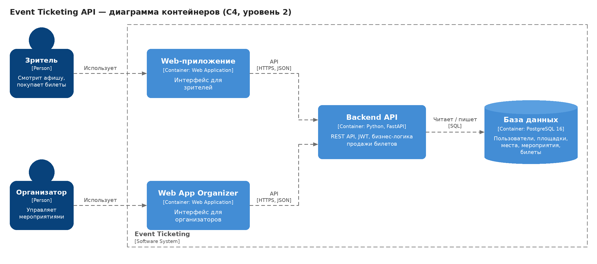
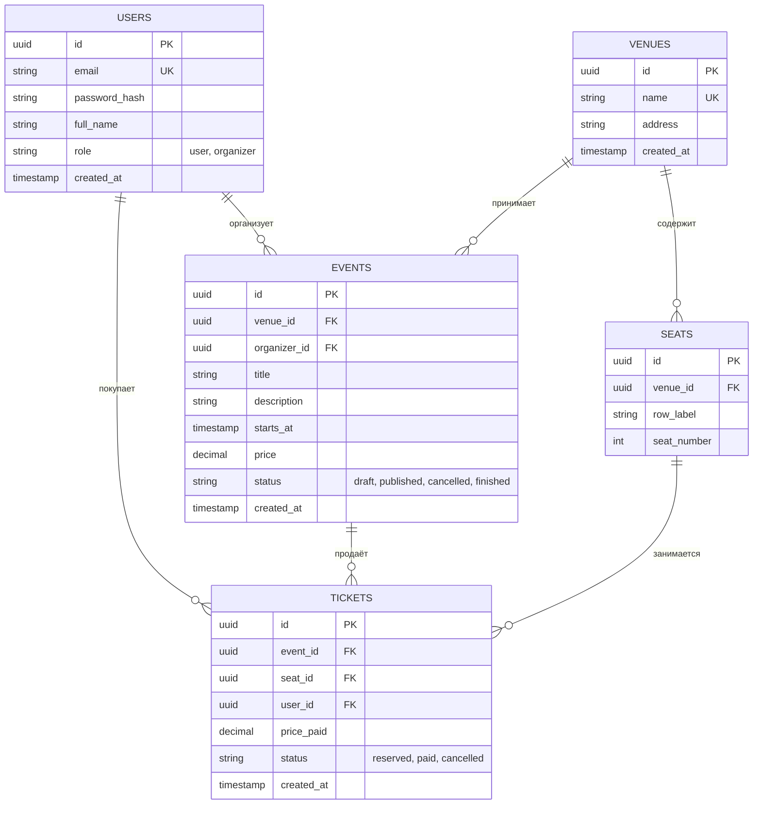

# Event Ticketing API — архитектура

## 1. Название и описание проекта

**Event Ticketing API** — серверное приложение (REST API) для продажи билетов на мероприятия.

Организатор заводит площадки со схемой мест и публикует мероприятия. Зрители просматривают афишу, выбирают свободное место и покупают билет. Сервер гарантирует, что одно и то же место на одно мероприятие не будет продано дважды, в том числе при одновременных запросах (race condition).

**Планируемый стек:** Python 3.11, FastAPI, PostgreSQL 16, Alembic (миграции), Docker и Docker Compose.

**Стиль архитектуры:** монолитное приложение со слоистой структурой (Controller → Service → Repository). Для учебного проекта с одной предметной областью микросервисы избыточны.

## 2. Ролевая модель и Use Cases

### Роли

| Роль | Код | Описание |
|---|---|---|
| Зритель | `user` | Покупает и отменяет билеты, просматривает афишу и свои билеты |
| Организатор | `organizer` | Управляет площадками и мероприятиями, видит продажи, может отменять любые билеты |

Неавторизованный посетитель может только зарегистрироваться и войти.

### Use Cases: зритель

| № | Сценарий |
|---|---|
| UC-1 | Зарегистрироваться и войти в систему (получить токен) |
| UC-2 | Просмотреть афишу: список мероприятий с фильтром по статусу и постраничной выдачей |
| UC-3 | Посмотреть места мероприятия и увидеть, какие свободны, а какие заняты |
| UC-4 | Купить билет на свободное место |
| UC-5 | Посмотреть список своих билетов |
| UC-6 | Отменить свой билет (место снова становится свободным) |

### Use Cases: организатор

| № | Сценарий |
|---|---|
| UC-7 | Создать площадку и задать её места (ряды и номера) |
| UC-8 | Создать мероприятие на площадке (название, дата, цена) |
| UC-9 | Изменить статус мероприятия (опубликовать, отменить, завершить) |
| UC-10 | Просмотреть проданные билеты по мероприятию |
| UC-11 | Отменить любой билет |
| UC-12 | Удалить мероприятие, на которое не продано ни одного билета |

### Основные бизнес-правила

1. Одно место на одно мероприятие нельзя продать дважды: защита на уровне БД (уникальный индекс) и на уровне сервиса (транзакция с блокировкой строки).
2. Билеты продаются только на мероприятия со статусом `published` и датой в будущем.
3. Место должно принадлежать площадке, на которой проходит мероприятие (проверяется в сервисном слое).
4. Цена билета фиксируется в момент покупки и не меняется при изменении цены мероприятия.
5. Отменённый билет не удаляется (история сохраняется), а место освобождается для повторной продажи.
6. Мероприятие и место с проданными билетами удалить нельзя, их можно только отменить.
7. Зритель видит и отменяет только свои билеты, организатор управляет всеми.

## 3. Диаграмма C4 Container (уровень 2)

Исходный файл диаграммы: [`docs/diagrams/c4-container.svg`](docs/diagrams/c4-container.svg).

| Контейнер | Технология | Назначение |
|---|---|---|
| Web-приложение | Web Application | Интерфейс зрителя: афиша, покупка и отмена билетов |
| Web App Organizer | Web Application | Интерфейс организатора: площадки, мероприятия, продажи |
| Backend API | Python 3.11, FastAPI | Приём запросов, проверка прав, бизнес-логика, доступ к данным |
| База данных | PostgreSQL 16 | Постоянное хранение данных |

Работа с API в рамках курса демонстрируется через Swagger UI и Postman. Применение миграций (Alembic) относится к запуску окружения и описывается в `docker-compose.yml`, а не к архитектурным контейнерам.

Кэш и очередь сообщений в проекте не используются: нагрузка и бизнес-логика этого не требуют.

## 4. ER-диаграмма базы данных (3NF)

Исходный код: [`docs/diagrams/erd.mmd`](docs/diagrams/erd.mmd). Экспортированное изображение: `docs/diagrams/erd.png`.

### Описание таблиц и полей

#### `users` — пользователи

| Поле | Тип | Ограничения |
|---|---|---|
| `id` | UUID | PK, `DEFAULT gen_random_uuid()` |
| `email` | VARCHAR(255) | NOT NULL, UNIQUE |
| `password_hash` | VARCHAR(255) | NOT NULL |
| `full_name` | VARCHAR(100) | NOT NULL |
| `role` | VARCHAR(20) | NOT NULL, DEFAULT `'user'`, CHECK (`user`, `organizer`) |
| `created_at` | TIMESTAMPTZ | NOT NULL, DEFAULT `now()` |

#### `venues` — площадки

| Поле | Тип | Ограничения |
|---|---|---|
| `id` | UUID | PK |
| `name` | VARCHAR(150) | NOT NULL, UNIQUE |
| `address` | VARCHAR(255) | NOT NULL |
| `created_at` | TIMESTAMPTZ | NOT NULL, DEFAULT `now()` |

#### `seats` — места на площадке

| Поле | Тип | Ограничения |
|---|---|---|
| `id` | UUID | PK |
| `venue_id` | UUID | NOT NULL, FK → `venues(id)` ON DELETE CASCADE |
| `row_label` | VARCHAR(10) | NOT NULL |
| `seat_number` | INT | NOT NULL, CHECK (`seat_number > 0`) |
| | | UNIQUE (`venue_id`, `row_label`, `seat_number`) |

#### `events` — мероприятия

| Поле | Тип | Ограничения |
|---|---|---|
| `id` | UUID | PK |
| `venue_id` | UUID | NOT NULL, FK → `venues(id)` ON DELETE RESTRICT |
| `organizer_id` | UUID | NOT NULL, FK → `users(id)` ON DELETE RESTRICT |
| `title` | VARCHAR(200) | NOT NULL |
| `description` | TEXT | может быть пустым |
| `starts_at` | TIMESTAMPTZ | NOT NULL |
| `price` | NUMERIC(10, 2) | NOT NULL, CHECK (`price >= 0`) |
| `status` | VARCHAR(20) | NOT NULL, DEFAULT `'draft'`, CHECK (`draft`, `published`, `cancelled`, `finished`) |
| `created_at` | TIMESTAMPTZ | NOT NULL, DEFAULT `now()` |

#### `tickets` — билеты

| Поле | Тип | Ограничения |
|---|---|---|
| `id` | UUID | PK |
| `event_id` | UUID | NOT NULL, FK → `events(id)` ON DELETE RESTRICT |
| `seat_id` | UUID | NOT NULL, FK → `seats(id)` ON DELETE RESTRICT |
| `user_id` | UUID | NOT NULL, FK → `users(id)` ON DELETE CASCADE |
| `price_paid` | NUMERIC(10, 2) | NOT NULL, CHECK (`price_paid >= 0`) |
| `status` | VARCHAR(20) | NOT NULL, DEFAULT `'reserved'`, CHECK (`reserved`, `paid`, `cancelled`) |
| `created_at` | TIMESTAMPTZ | NOT NULL, DEFAULT `now()` |

### Связи

| Связь | Тип | Пояснение |
|---|---|---|
| `venues` → `seats` | 1:N | У площадки много мест, место принадлежит одной площадке |
| `venues` → `events` | 1:N | На площадке проходит много мероприятий |
| `users` → `events` | 1:N | Организатор создаёт много мероприятий |
| `users` → `tickets` | 1:N | Зритель покупает много билетов |
| `events` → `tickets` | 1:N | На мероприятие продаётся много билетов |
| `seats` → `tickets` | 1:N | Одно место продаётся на разные мероприятия |
| `events` ↔ `seats` | N:M | Реализована через таблицу `tickets` (место на мероприятие, один билет на пару) |

### Правила удаления (`ON DELETE`)

| Связь | Правило | Обоснование |
|---|---|---|
| `seats.venue_id` | CASCADE | Места не существуют без площадки |
| `events.venue_id` | RESTRICT | Нельзя удалить площадку, на которой есть мероприятия |
| `events.organizer_id` | RESTRICT | История мероприятий не должна теряться вместе с организатором |
| `tickets.event_id` | RESTRICT | Нельзя удалить мероприятие с проданными билетами, его отменяют |
| `tickets.seat_id` | RESTRICT | Нельзя удалить место, на которое есть билеты |
| `tickets.user_id` | CASCADE | При удалении аккаунта его билеты удаляются и места освобождаются |

### Индексы

| Индекс | Назначение |
|---|---|
| `UNIQUE (event_id, seat_id) WHERE status <> 'cancelled'` | Защита от двойной продажи; отменённый билет не блокирует повторную продажу места |
| `idx_tickets_event_id (event_id)` | Индекс внешнего ключа, список билетов мероприятия |
| `idx_tickets_user_id (user_id)` | Индекс внешнего ключа, «мои билеты» |
| `idx_tickets_seat_id (seat_id)` | Индекс внешнего ключа |
| `idx_events_status_starts_at (status, starts_at)` | Афиша: фильтр по статусу и сортировка по дате |
| `idx_events_venue_id (venue_id)`, `idx_events_organizer_id (organizer_id)` | Индексы внешних ключей |
| `UNIQUE (venue_id, row_label, seat_number)` в `seats` | Уникальность места; одновременно покрывает поиск по `venue_id` |

### Соответствие третьей нормальной форме

- Все поля атомарны, у каждой таблицы есть первичный ключ (1NF, 2NF).
- Нет транзитивных зависимостей: адрес площадки хранится только в `venues`, данные организатора берутся из `users` по `organizer_id`, данные места только в `seats`.
- Поле `tickets.price_paid` не нарушает 3NF: это зафиксированная на момент покупки цена, то есть самостоятельный факт, а не копия `events.price`. Благодаря ему изменение цены мероприятия не меняет стоимость уже купленных билетов.
